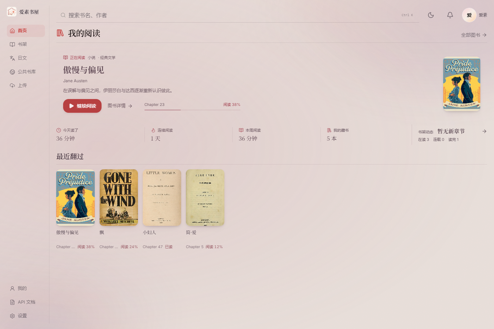
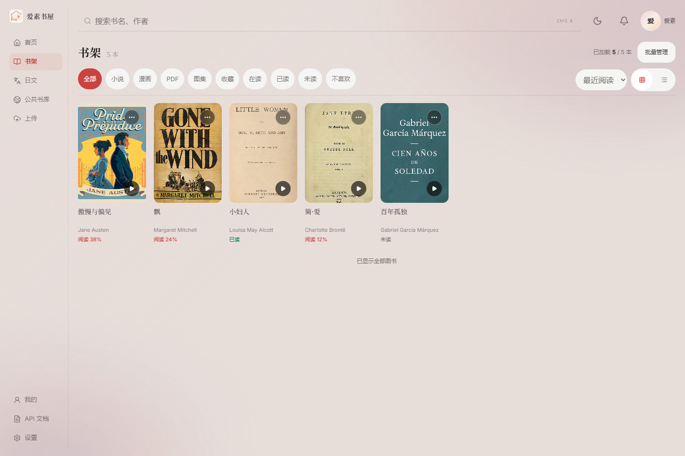
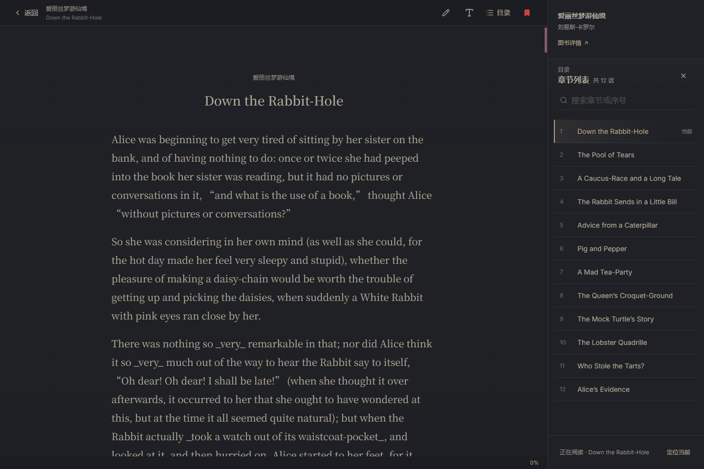

<div align="center">
  <picture>
    <source media="(prefers-color-scheme: dark)" srcset="public/aisu-brand.svg">
    
  </picture>
  <h1>爱素书屋</h1>
  <p>自部署的在线书库，支持小说、漫画和 PDF，以及翻译和听书。</p>
  <p>
    <a href="LICENSE"></a>
    
    
    
  </p>
  <p><a href="#界面预览">界面预览</a> · <a href="#功能">功能</a> · <a href="#本地运行">本地运行</a> · <a href="docs/deployment.md">部署说明</a> · <a href="https://github.com/taffy-owo/aisu-bookhouse/issues">反馈问题</a></p>
</div>

## 界面预览

<picture>
  <source media="(prefers-color-scheme: dark)" srcset="docs/images/home-dark.png">
  
</picture>

<table>
  <tr>
    <td width="50%"><p align="center">书架</p></td>
    <td width="50%"><p align="center">夜间阅读</p></td>
  </tr>
</table>

## 功能

| 功能 | 说明 |
| --- | --- |
| 图书导入 | 支持 EPUB、TXT、MOBI、PDF、ZIP/CBZ 漫画压缩包和图片 |
| 书架管理 | 搜索、收藏、标签、系列分组和阅读状态；可将图书提交到公共书库 |
| 阅读 | 调整字体、字号、行距和背景，切换日间与夜间主题；支持滚动阅读和轻点翻页 |
| PDF | 原页缩放、缩略图导航、文本阅读、纸色和亮度调整 |
| 漫画与图片 | 逐页阅读、缩放和页码跳转 |
| 日文与翻译 | 日文阅读辅助、整书翻译、译稿审核和来源更新，需自行配置模型服务 |
| 听书 | 支持在线语音和设备朗读，可调节语速 |
| 阅读记录 | 保存阅读进度、书签和备注，登录同一账号即可跨设备续读 |
| 账号与管理 | 邀请注册、权限管理、SQLite 备份恢复和个人 API |

## 本地运行

需要 **Node.js 22.13+（或 24+）**、**Python 3.11** 和 Git。默认使用 SQLite，无需另装数据库。

### 1. 获取源码

```bash
git clone https://github.com/taffy-owo/aisu-bookhouse.git
cd aisu-bookhouse
```

### 2. 启动后端

```bash
cd backend
python -m venv .venv
source .venv/bin/activate
python -m pip install -r requirements.txt
cp .env.example .env
```

编辑 `backend/.env`，填写管理员邮箱、密码、JWT 密钥和加密密钥，然后启动：

```bash
python -m uvicorn app.main:app --reload --host 127.0.0.1 --port 8000 --env-file .env
```

<details>
<summary>Windows PowerShell</summary>

```powershell
cd backend
python -m venv .venv
.\.venv\Scripts\Activate.ps1
python -m pip install -r requirements.txt
Copy-Item .env.example .env
# 编辑 .env 后启动
python -m uvicorn app.main:app --reload --host 127.0.0.1 --port 8000 --env-file .env
```

</details>

### 3. 启动前端

另开一个终端，在项目根目录执行：

```bash
npm ci
cp .env.example .env.local
npm run dev
```

PowerShell 使用 `Copy-Item .env.example .env.local` 复制配置。

打开终端显示的地址（通常为 `http://localhost:5173`），用配置好的管理员账号登录并上传图书。其他用户需要邀请码注册，管理员可以在网站中创建邀请码。

整书翻译和定时检查来源更新还需要启动 [后台 worker](docs/deployment.md#服务与-worker)。

服务器部署、独立 worker 和生产环境配置见 [部署说明](docs/deployment.md)。后端接口文档位于 `http://127.0.0.1:8000/docs`。

## 开发

前端使用 React、TypeScript、Vite 和 Tailwind CSS；后端使用 FastAPI、SQLAlchemy 和 Alembic，支持 SQLite 与 PostgreSQL。

```text
src/                前端页面与阅读器
backend/app/        后端 API 与业务逻辑
backend/alembic/    数据库迁移
backend/tests/      后端测试
public/             图标与字体
docs/               部署文档与截图
```

```bash
npm run lint
npm test
npm run build
python -m pip install -r backend/requirements-dev.txt
cd backend
python -m pytest tests
```

提交问题或参与开发，请看 [贡献指南](CONTRIBUTING.md)。安全问题请按 [安全说明](SECURITY.md) 私下报告。

## 许可

[MIT License](LICENSE) · [第三方许可](THIRD_PARTY_NOTICES.md)
